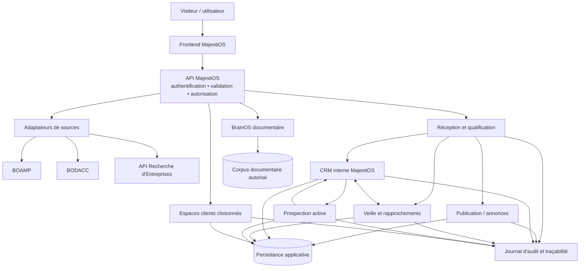
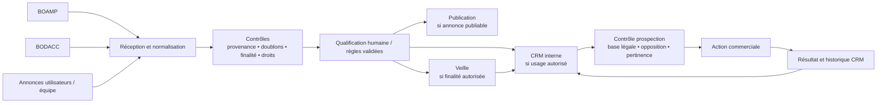
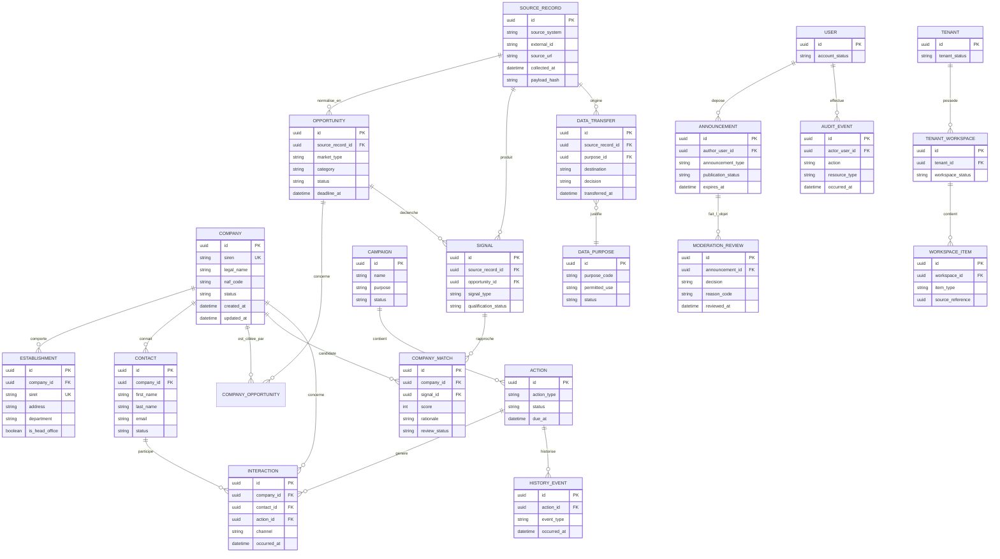
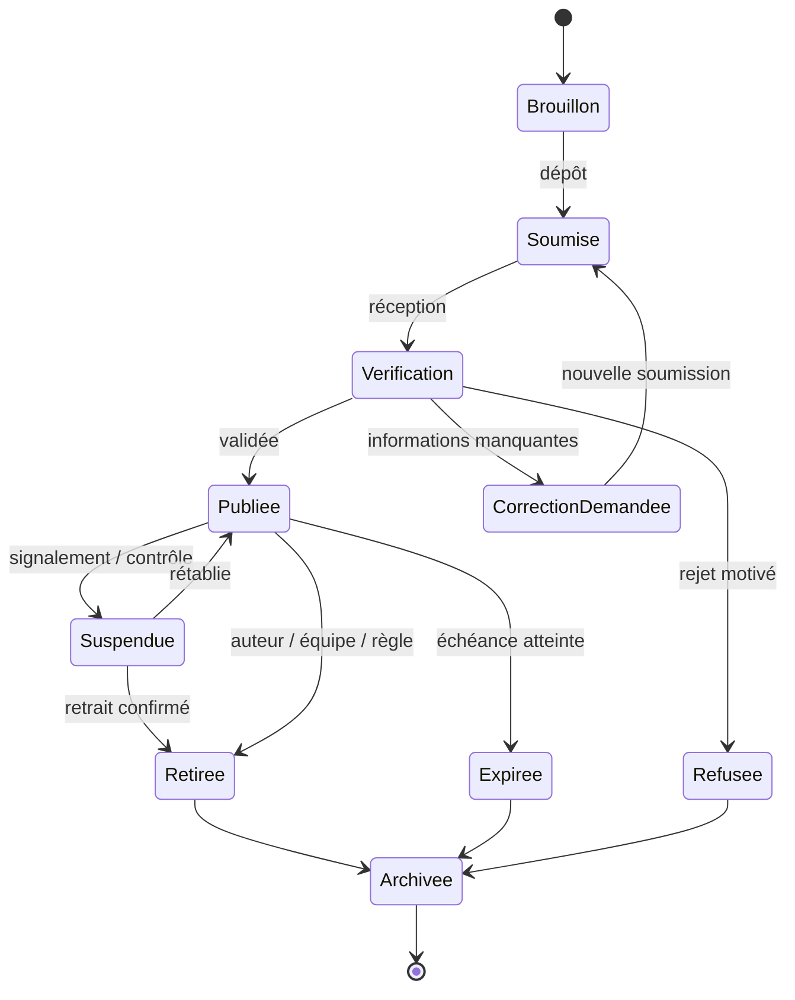
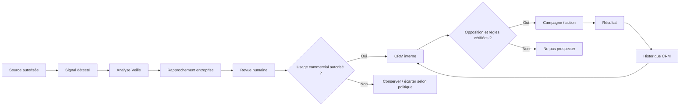

# MajestiOS — Architecture API cible

**Version :** 0.1 — proposition d'architecture documentaire  
**Date :** 3 novembre 2026  
**Branche :** `evolution-3.0`  
**Statut :** proposition structurante à auditer et à faire valider — non implémentée  
**Périmètre :** architecture logique, frontières fonctionnelles, modèle conceptuel, API, événements, sécurité et migration du prototype.

> Ce document traduit les décisions fonctionnelles de référence et les diagrammes proposés en une architecture cible cohérente. Il ne décrit pas l'architecture actuellement déployée. Les technologies, contrats définitifs, règles de conservation et autorisations restent à arbitrer. Le fichier Markdown synthétique transmis par lien Skype n'a pas pu être récupéré dans l'environnement de travail ; cette version est donc une reconstruction documentée à partir des sources disponibles dans le dépôt et des orientations formulées dans la conversation, et non une révision ligne à ligne de ce fichier.

## 1. Résumé exécutif

MajestiOS doit devenir une plateforme de développement commercial organisée autour d'un référentiel CRM central. Les moteurs de recherche, la collecte de sources, la publication d'annonces, la Veille, la Prospection active et les espaces clients sont des capacités spécialisées. Elles ne partagent des données qu'au moyen de règles explicites, traçables et contrôlées.

L'architecture cible repose sur six principes :

1. **API comme frontière applicative :** le navigateur ne contacte pas directement les sources externes et ne porte pas les règles sensibles.
2. **Modules à responsabilités distinctes :** collecte, qualification, publication, CRM, Veille, Prospection, espaces clients et BrainOS ont des périmètres explicites.
3. **CRM central, accès cloisonné :** le CRM interne MajestiOS est le référentiel commercial de l'opérateur ; les espaces clients sont des espaces de travail séparés, pas des vues ouvertes du CRM interne.
4. **Circulation conditionnelle :** aucune annonce ou donnée ne passe automatiquement de Publication vers CRM, Veille ou Prospection sans contrôle de finalité, de provenance, de droits et de statut.
5. **Événements traçables :** chaque changement significatif peut être expliqué, rejoué de manière sûre ou corrigé sans créer de doublons.
6. **Migration progressive :** le prototype statique est préservé ; les services connectés sont construits et validés par étapes isolées.

## 2. Architecture globale

Le schéma décrit les responsabilités logiques. Il ne prescrit ni microservices, ni fournisseur cloud, ni base de données. Une première réalisation peut rester un monolithe modulaire derrière une API versionnée, si les frontières internes sont respectées.



**Lecture du schéma :** les adaptateurs isolent les particularités des fournisseurs. L'API applique les contrôles d'identité et d'autorisation. La réception/qualification décide si une donnée peut être publiée, rapprochée au CRM, analysée par la Veille ou utilisée pour préparer une action commerciale. Les flèches représentent des échanges possibles, pas des autorisations implicites.

### 2.1 Responsabilités des composants

| Composant | Responsabilité | Interdiction / limite |
|---|---|---|
| Frontend | Présentation, saisie, navigation, affichage des résultats autorisés | Ne détient ni secret fournisseur ni règle d'autorisation de confiance |
| API MajestiOS | Authentification, autorisation, validation, orchestration, contrats versionnés | Ne contourne pas les règles de finalité ou de cloisonnement |
| Adaptateurs sources | Appels BOAMP, BODACC et Recherche d'Entreprises ; normalisation et provenance | Ne transforment pas un signal en cible commerciale automatiquement |
| Réception / qualification | Contrôles, dédoublonnage, modération, rapprochement et décisions de routage | Ne publie ni ne transmet sans règle applicable |
| Publication | Gestion du cycle de vie et des champs publiables des annonces | N'expose pas les données internes de l'auteur |
| CRM interne | Référentiel commercial MajestiOS, relations, actions et historique | N'est pas accessible aux clients |
| Veille | Détection, analyse, rapprochement et qualification de signaux | Ne conclut pas à la capacité réelle d'une entreprise sur le seul APE/NAF |
| Prospection active | Préparation et suivi des actions commerciales autorisées | Respecte opposition, désinscription, finalités et règles applicables |
| Espaces clients | Données et dossiers propres à un client, plus partages explicitement autorisés | Aucun accès au CRM interne ou aux autres clients |
| BrainOS | Recherche et organisation de documents autorisés | Aucun accès implicite au CRM, aux contacts ou aux campagnes |
| Journal d'audit | Historique des accès sensibles, décisions et transmissions | Ne doit pas devenir un dépôt incontrôlé de données personnelles |

## 3. Flux métier principal



Ce flux n'autorise pas une alimentation automatique universelle. Les conditions de transmission sont déterminées par type de source, finalité, statut, champs, droits et décision de qualification.

### 3.1 Scénario de référence BOAMP

1. Un avis BOAMP est collecté par un adaptateur côté serveur.
2. L'identifiant externe, l'URL officielle, la date de collecte et les métadonnées de source sont conservés.
3. La Veille analyse l'avis et détermine les activités potentiellement concernées.
4. Les codes APE/NAF peuvent servir de présélection, avec d'autres critères ; ils ne démontrent ni compétence ni capacité.
5. Une revue humaine valide, corrige ou rejette les rapprochements utiles.
6. Le lien avis ↔ entreprise et les raisons de rapprochement sont enregistrés.
7. Les éléments autorisés sont transmis au CRM interne.
8. Une action de Prospection active n'est préparée que si l'usage est autorisé et que les contrôles requis sont satisfaits.
9. Les actions, oppositions, relances et résultats sont historisés.

### 3.2 Annonces utilisateurs

Le parcours cible comprend dépôt, identification de l'auteur, contrôle, demande éventuelle de correction, décision de publication, expiration/retrait et archivage. Les règles exactes de vérification de l'auteur, modération, signalement et conservation restent à valider.

Une annonce publique expose uniquement les champs approuvés. Les coordonnées de l'auteur, les données de compte et les informations de gestion restent dans leur périmètre. Le dépôt ou la publication ne constitue pas, à lui seul, une autorisation générale de réutilisation commerciale.

## 4. Frontières fonctionnelles et règles de périmètre

| Domaine | Périmètre initial retenu | Hors périmètre initial / différé |
|---|---|---|
| Marchés publics | BOAMP ; cinq catégories sélectionnées après mesure réelle des volumes et validées par le porteur | Catégories non validées et autres sources non arbitrées |
| Marchés privés | BODACC : créations, ventes et cessions, modifications | Procédures collectives, radiations et immobilier |
| Emploi MajestiOS | Annonces déposées par les utilisateurs ou publiées par l'équipe MajestiOS | Import d'offres externes Cadremploi, France Travail, APEC |
| Publication | « Je publie mon annonce » : emploi, sous-traitance, demande, offre, autres annonces professionnelles pertinentes | Règles de dépôt et de modération à préciser |
| CRM | Référentiel commercial interne MajestiOS | Accès client direct au CRM interne |
| Veille | Analyse des signaux, rapprochement et qualification | Automatisation non validée ou fondée uniquement sur APE/NAF |
| Prospection active | Actions commerciales autorisées, traçables et opposables | Campagnes sans contrôle préalable de finalité et d'opposition |
| Espaces clients | Environnements isolés, dossiers et partages explicitement autorisés | Accès transversal entre clients |
| BrainOS | Corpus documentaire autorisé | Accès implicite aux données CRM ou aux espaces clients |

## 5. Modèle conceptuel des données

Le modèle ci-dessous est logique. Les noms, cardinalités et contraintes devront être traduits dans le schéma physique après arbitrage des règles métier. Les identifiants internes sont des UUID proposés ; les identifiants externes des fournisseurs sont conservés séparément.

### 5.1 Diagramme conceptuel CRM et traçabilité



### 5.2 Entités et règles de conception

- **Company / Establishment :** distinguer la personne morale (SIREN) de ses établissements (SIRET). L'unicité est contrôlée par identifiant légal lorsqu'il est disponible ; les cas incomplets ou étrangers nécessitent une stratégie distincte.
- **Contact :** une personne peut avoir plusieurs relations professionnelles au cours du temps. Éviter de traiter l'adresse email comme identifiant universel et immuable.
- **SourceRecord :** conserve la provenance brute ou une référence contrôlée, l'identifiant externe, l'URL, les dates de collecte, la version du normaliseur et une empreinte permettant de détecter les doublons ou changements.
- **Opportunity :** représente un marché ou une opportunité normalisée, sans confondre le signal source et l'entité commerciale.
- **Signal / CompanyMatch :** conserve les raisons du rapprochement, le score indicatif, les critères et le statut de revue humaine.
- **Campaign / Action / Interaction / HistoryEvent :** séparent une campagne, une action prévue, une interaction réellement survenue et son historique.
- **Announcement / ModerationReview :** séparent le contenu soumis, son auteur, son état de publication et les décisions de modération.
- **Tenant / TenantWorkspace :** portent le cloisonnement des environnements clients. Le CRM interne MajestiOS est un périmètre organisationnel distinct, non un tenant client.
- **DataPurpose / DataTransfer :** rendent explicites la finalité et la décision associées à une transmission. La preuve juridique et les règles exactes doivent être définies avec une compétence conformité appropriée.
- **AuditEvent :** trace les opérations sensibles sans recopier inutilement le contenu complet des données consultées.

### 5.3 Contraintes transversales

1. Toute donnée importée doit avoir une provenance et une date de collecte.
2. Les données source brutes, données normalisées et données qualifiées doivent être distinguables.
3. Les dédoublonnages doivent être idempotents et ne pas fusionner automatiquement des entités ambiguës.
4. Les suppressions, retraits, oppositions et expirations doivent être propagés selon des règles explicites et auditables.
5. Les scores de rapprochement sont explicables et ne valent jamais validation de capacité.
6. Les données internes CRM, les données d'un tenant et le corpus BrainOS sont séparés par des contrôles d'accès dédiés.

## 6. Cycle de vie des annonces



Les transitions doivent être autorisées par rôle, motivées et journalisées. Les durées, pièces justificatives, procédures de signalement, délais de correction et règles de réactivation restent à définir. Le diagramme constitue une proposition enrichie du cycle initial, pas une règle déjà validée.

## 7. Flux Veille → CRM → Prospection



Une entreprise rapprochée n'est pas nécessairement une cible de prospection. Le passage à l'action est un contrôle distinct, réévaluable avant chaque campagne et chaque contact.

## 8. Structure de l'API

### 8.1 Principes

- Préfixe versionné proposé : `/api/v1`.
- API documentée par un contrat OpenAPI versionné, généré ou vérifié en CI.
- Authentification et autorisation côté serveur ; aucune confiance dans un identifiant de tenant fourni librement par le navigateur.
- Validation stricte des entrées, pagination, filtres bornés, limites de débit et erreurs structurées.
- Les secrets BOAMP/BODACC ou autres fournisseurs ne sont jamais exposés au navigateur.
- Les opérations sensibles sont journalisées ; les mutations importantes supportent une clé d'idempotence.
- Les API internes intermodules peuvent partager le même déploiement au départ, mais doivent conserver des interfaces et permissions distinctes.

### 8.2 Domaines de routes proposés

| Domaine | Routes indicatives | Autorisation de principe |
|---|---|---|
| Authentification | `POST /auth/session`, `DELETE /auth/session`, `GET /auth/me` | Utilisateur concerné ; politique de session |
| Opportunités | `GET /opportunities`, `GET /opportunities/{id}` | Public pour les champs publiables ; accès interne pour enrichissements |
| Sources | `GET /sources/status` (interne) | Administrateur / opérateur |
| Entreprises | `GET /companies/{id}`, `POST /companies/match` | CRM interne ou rôle explicitement autorisé |
| Contacts | `GET /contacts/{id}`, `POST /contacts`, `PATCH /contacts/{id}` | Rôle CRM, finalité documentée |
| CRM | `GET /crm/companies`, `GET /crm/timeline` | Personnel MajestiOS autorisé |
| Veille | `GET /watch/signals`, `POST /watch/reviews` | Analyste / rôle autorisé |
| Prospection | `POST /prospecting/actions`, `POST /prospecting/suppressions` | Rôle prospection ; contrôles de conformité obligatoires |
| Annonces | `POST /announcements`, `GET /announcements`, `POST /announcements/{id}/submit` | Auteur authentifié / champs publics |
| Modération | `POST /moderation/{id}/decision` | Modérateur habilité |
| Espaces clients | `GET /workspaces/{id}`, `GET /workspaces/{id}/items` | Membres du tenant correspondant uniquement |
| BrainOS | `POST /brainos/search`, `GET /brainos/documents/{id}` | Accès au corpus documentaire autorisé |
| Audit | `GET /audit/events` | Auditeur / administrateur autorisé |

Ces routes sont des exemples de découpage, pas des endpoints existants. Les contrats finaux doivent préciser schémas, champs, codes HTTP, erreurs, filtres, pagination, limites, scopes et règles de visibilité.

### 8.3 Enveloppe de réponse indicative

```json
{
  "data": {},
  "meta": {
    "request_id": "uuid",
    "page": 1,
    "page_size": 10,
    "has_more": false
  },
  "error": null
}
```

Pour une erreur, `data` vaut `null` et `error` contient un code stable, un message sûr pour l'utilisateur et, si nécessaire, des détails de validation sans fuite d'information sensible.

### 8.4 Contrat d'une transmission

Toute transmission intermodule doit comporter au minimum :

- identifiant de transmission ;
- référence de l'objet source et sa provenance ;
- module émetteur et module destinataire ;
- finalité et règle d'autorisation évaluées ;
- champs transmis ou référence de projection ;
- acteur ou processus déclencheur ;
- date, statut et motif de décision ;
- identifiant de corrélation et résultat du traitement.

## 9. Architecture événementielle cible

Les événements décrivent des faits accomplis, au passé, et non des commandes ambiguës. Ils sont versionnés, identifiés et idempotents. Les événements ne remplacent pas les autorisations : le consommateur réévalue les règles applicables au moment de l'action.

```mermaid
flowchart LR
    SOURCE[Adaptateur source]
    OPP[opportunity.detected]
    SIGNAL[signal.created]
    MATCH[company.match.proposed]
    REVIEW[company.match.reviewed]
    CRM[crm.record.linked]
    ELIGIBLE[prospecting.eligibility.checked]
    ACTION[prospecting.action.created]
    DONE[prospecting.action.completed]
    HISTORY[crm.history.recorded]

    SOURCE --> OPP --> SIGNAL --> MATCH --> REVIEW --> CRM
    CRM --> ELIGIBLE
    ELIGIBLE --> ACTION --> DONE --> HISTORY
    HISTORY --> CRM
```



### 9.1 Catalogue initial d'événements proposés

| Événement | Déclencheur | Consommateurs possibles | Garde-fou |
|---|---|---|---|
| `source.record.collected` | Réception d'un enregistrement source | Normalisation, dédoublonnage | Provenance et conditions de source |
| `opportunity.detected` | Opportunité normalisée | Veille | Identifiant externe et idempotence |
| `signal.created` | Signal métier qualifié initialement | Veille | Pas d'affirmation de capacité |
| `company.match.proposed` | Rapprochement calculé | Revue humaine | Score explicable, statut « proposé » |
| `company.match.reviewed` | Décision humaine | CRM, Veille | Acteur, date, motif |
| `announcement.submitted` | Dépôt par un auteur | Modération | Identité et anti-abus |
| `announcement.moderated` | Décision de modération | Publication, auteur | Rôle et motif |
| `announcement.published` | Publication autorisée | Catalogue public | Projection des seuls champs publics |
| `data.transfer.authorized` | Décision de transmission | Module destinataire | Finalité, règle, champs et destination |
| `prospecting.eligibility.checked` | Vérification avant action | Prospection | Opposition, finalité et règles applicables |
| `prospecting.action.created` | Action autorisée créée | CRM, opérateur | Idempotence et acteur |
| `prospecting.action.completed` | Action terminée | CRM | Résultat et date |
| `contact.objection.registered` | Opposition / désinscription reçue | Prospection, CRM | Propagation rapide et preuve |
| `workspace.share.granted` | Partage explicite accordé | Espace client | Périmètre et expiration du partage |

### 9.2 Enveloppe d'événement indicative

```json
{
  "event_id": "uuid",
  "event_type": "company.match.reviewed",
  "event_version": 1,
  "occurred_at": "2026-11-03T14:00:00Z",
  "producer": "watch",
  "correlation_id": "uuid",
  "causation_id": "uuid",
  "actor": {
    "type": "user",
    "id": "uuid"
  },
  "subject": {
    "type": "company_match",
    "id": "uuid"
  },
  "data": {
    "decision": "accepted",
    "reason_code": "human_review"
  }
}
```

### 9.3 Garanties opérationnelles

- Publication d'événement et écriture métier cohérentes via un mécanisme transactionnel de type outbox, si la technologie retenue le permet.
- Consommateurs idempotents et détection des doublons par `event_id` ou clé métier.
- Reprises bornées, file d'échec / quarantaine et procédure de rejeu contrôlée.
- Ordre garanti uniquement lorsque nécessaire et dans un périmètre explicitement défini.
- Aucun événement ne doit contenir plus de données personnelles que nécessaire.
- Journalisation des décisions et des erreurs, avec métriques de retard et de taux d'échec.

## 10. Matrice des flux intermodules

| Émetteur | Destinataire | Données / événement | Condition obligatoire | Interdit par défaut |
|---|---|---|---|---|
| Adaptateur BOAMP | Veille | Avis, provenance, dates | Source et conditions vérifiées | Prospection directe automatique |
| Adaptateur BODACC | Veille | Signal BODACC normalisé | Catégorie dans le périmètre retenu | Réintroduire procédures collectives/radiations |
| Recherche entreprises | Veille | Fiches et critères de rapprochement | Critères documentés, limite APE/NAF affichée | Déduire compétence ou capacité |
| Dépôt annonce | Modération | Contenu soumis et référence auteur | Contrôle d'accès et anti-abus | Publication immédiate |
| Modération | Publication | Projection des champs validés | Décision de publication | Exposer données internes |
| Annonce publiée | CRM | Référence et champs nécessaires | Finalité et droits évalués | Importer automatiquement toutes les coordonnées |
| Annonce / signal | Veille | Référence et données nécessaires | Règle de transmission validée | Réutilisation générale non prévue |
| Veille | CRM interne | Signal, analyse, rapprochement, motif | Revue/validation selon règle | Écraser une donnée CRM sans historique |
| CRM interne | Prospection | Cible et contexte autorisés | Éligibilité et opposition vérifiées | Campagne sur cible non autorisée |
| Prospection | CRM interne | Actions, interactions, résultats | Traçabilité de l'action | Effacer les oppositions |
| CRM interne | Espace client | Dossier ou opportunité sélectionnée | Partage explicite, minimisation, tenant correct | Accès au CRM global |
| Espace client | CRM interne | Retour ou document soumis | Contrôle, attribution et droits | Accès croisé entre clients |
| Corpus autorisé | BrainOS | Documents explicitement autorisés | Droits documentaires et périmètre validés | Accès implicite au CRM |

## 11. Sécurité, identité et autorisations

### 11.1 Principes d'identité

Les rôles et permissions doivent être vérifiés côté serveur à chaque requête sensible. Les identifiants transmis par le navigateur ne sont jamais suffisants pour prouver l'appartenance à un tenant ou un droit d'accès.

Rôles à spécifier, sans présumer de la matrice finale :

- visiteur public ;
- utilisateur / auteur d'annonce ;
- membre d'un espace client ;
- administrateur de tenant ;
- opérateur MajestiOS ;
- analyste Veille ;
- opérateur CRM ;
- opérateur Prospection ;
- modérateur ;
- administrateur technique ;
- auditeur.

Le cumul de rôles doit être explicite, limité et auditable.

### 11.2 Cloisonnement des données

Trois périmètres doivent être séparés logiquement et techniquement :

1. **Interne MajestiOS :** CRM interne, sources, qualification, prospection, modération et opérations.
2. **Tenant client :** dossiers, documents, actions et données appartenant au client, accessibles uniquement aux membres autorisés.
3. **Corpus BrainOS :** documents autorisés et index documentaire avec permissions propres.

Une donnée ne traverse pas ces périmètres par simple disponibilité dans la base. Tout partage doit être explicite, limité en champs, en finalité et en durée, et journalisé.

### 11.3 Contrôles de sécurité à intégrer

- authentification robuste, gestion de session, révocation et récupération de compte ;
- autorisation par rôle et par ressource, avec vérification du tenant côté serveur ;
- protection contre IDOR/BOLA, CSRF si applicable, XSS, injection et abus de formulaire ;
- limitation de débit, validation de schéma et tailles maximales ;
- secrets dans un gestionnaire adapté, jamais dans le dépôt ou le bundle frontend ;
- chiffrement en transit et protection des sauvegardes ;
- journal d'audit à accès restreint, sans secrets ni charges utiles excessives ;
- sauvegardes testées, restauration documentée et rétention définie ;
- tests automatisés de séparation entre tenants et entre CRM interne / espaces clients ;
- analyse des dépendances et revue de sécurité avant ouverture publique.

### 11.4 Prospection et conformité

Avant chaque usage de données pour une action commerciale, le système doit pouvoir vérifier et conserver la finalité, la source, la pertinence, les règles applicables, les oppositions et désinscriptions, ainsi que la preuve de la décision. Les bases juridiques, obligations d'information, durées et modalités de prospection devront être définies avec une expertise juridique/RGPD appropriée. Cette architecture ne constitue pas un avis juridique.

## 12. Observabilité, qualité et exploitation

Chaque requête reçoit un identifiant de corrélation. Les journaux techniques distinguent erreurs fournisseur, erreurs de validation, refus d'autorisation, échecs de traitement et erreurs métier. Les données sensibles sont masquées ou exclues des logs.

Indicateurs minimum à prévoir :

- disponibilité et latence par endpoint ;
- taux d'erreur et limites fournisseur par source ;
- volume collecté, doublons et enregistrements rejetés ;
- retard et échecs de traitement des événements ;
- transmissions autorisées, refusées et en attente ;
- annonces en attente de modération et délai de traitement ;
- échecs d'authentification et tentatives d'accès inter-tenant ;
- coût de collecte, stockage et traitement.

Les conditions d'utilisation, quotas, limites, politiques de cache et possibilités de réutilisation de BOAMP, BODACC et de l'API Recherche d'Entreprises doivent être vérifiés avant automatisation et périodiquement ensuite.

## 13. Migration depuis le prototype actuel

L'audit de phase 1 décrit un prototype HTML/CSS/JavaScript statique, sans serveur applicatif, base de données, authentification, persistance ni CRM opérationnel. Les appels BOAMP, BODACC et Recherche d'Entreprises partent actuellement du navigateur. Les modules CRM, Veille, Prospection, espaces clients et BrainOS sont principalement des pages de présentation.

La migration ne doit pas être une réécriture globale. Elle doit préserver l'expérience et les ressources visuelles validées tout en remplaçant progressivement les responsabilités sensibles par des services serveur.

### Phase A — Stabiliser et geler la référence

- Conserver le prototype actuel et ses tests comme référence fonctionnelle.
- Inventorier les routes, ressources, formulaires, appels sources et comportements.
- Maintenir les contrôles build, architecture, liens et tests navigateur.
- Ne pas modifier les catégories tant que les arbitrages restent ouverts.

**Critère de sortie :** état de référence reproductible et inventaire à jour.

### Phase B — Définir le socle technique

- Comparer les options de backend, persistance, authentification, stockage et tâches asynchrones.
- Évaluer coûts, limites, sécurité, conditions des sources et réversibilité.
- Définir le schéma physique initial, les migrations, sauvegardes et environnements.
- Rédiger OpenAPI et matrice des rôles avant de coder les parcours sensibles.

**Critère de sortie :** choix techniques documentés et validés, contrats et contrôles de sécurité relus.

### Phase C — Construire le socle serveur isolé

- Créer API versionnée et gestion des secrets.
- Implémenter identité, rôles, audit et cloisonnement.
- Ajouter persistance minimale et migrations.
- Tester les accès interdits avant d'ajouter les fonctions métier.

**Critère de sortie :** tests positifs et négatifs d'identité et d'isolation passés.

### Phase D — Déplacer les intégrations de sources

- Implémenter les adaptateurs BOAMP, BODACC et Recherche d'Entreprises côté serveur.
- Normaliser les résultats, conserver provenance, cache éventuel et limites.
- Ajouter tests simulés, tests de contrat et smoke tests réseau séparés.
- Retirer progressivement les appels directs du navigateur, après validation de parité.

**Critère de sortie :** résultats cohérents, erreurs explicites, quotas contrôlés et provenance conservée.

### Phase E — Mettre en place le CRM et les flux

- Créer entreprises, établissements, contacts, opportunités, signaux et historique.
- Ajouter dédoublonnage et revue humaine.
- Introduire les événements et les transmissions auditées.
- Démontrer le scénario BOAMP → Veille → rapprochement → CRM.

**Critère de sortie :** scénario de bout en bout traçable, idempotent et réversible.

### Phase F — Publication et espaces clients

- Développer dépôt, modération, publication, retrait et expiration.
- Définir le modèle de tenant et les partages.
- Tester l'impossibilité d'accès croisé entre clients et au CRM interne.
- N'ajouter BrainOS qu'avec son corpus et ses permissions indépendants.

**Critère de sortie :** parcours annonce et espace client testés avec jeux de données cloisonnés.

### Phase G — Prospection et déploiement contrôlé

- Implémenter les contrôles d'éligibilité, opposition et désinscription.
- Construire les actions, relances et retours historisés.
- Réaliser tests sécurité, conformité, charge, coûts et restauration.
- Déployer d'abord en environnement de prévisualisation isolé ; production uniquement après autorisation explicite.

**Critère de sortie :** validation fonctionnelle, sécurité, conformité, coûts et feu vert explicite.

## 14. Décisions techniques encore ouvertes

Aucun des choix suivants ne doit être présenté comme validé avant comparaison et arbitrage :

- framework et runtime backend ;
- architecture monolithe modulaire, services séparés ou fonctions ;
- fournisseur et moteur de base de données ;
- stratégie multi-tenant (schéma partagé avec politiques, schémas séparés ou bases séparées) ;
- fournisseur d'identité et modèle de rôles ;
- stockage documentaire et pièces jointes ;
- file d'événements, tâches asynchrones et mécanisme de reprise ;
- cache, fréquence de collecte et respect des conditions des sources ;
- fournisseur email et gestion des désinscriptions ;
- stratégie de sauvegarde, observabilité, environnements et coûts.

**Recommandation de méthode :** commencer par une architecture modulaire simple, avec des frontières de domaines et des contrats explicites. Ne retenir une séparation en services déployés distincts que si les besoins de sécurité, de charge, d'exploitation ou d'équipe la justifient.

## 15. Critères d'acceptation de l'architecture

L'architecture ne sera considérée comme prête pour une implémentation métier que lorsque les points suivants seront vérifiés :

- [ ] Le modèle distingue CRM interne, données de publication, Veille, Prospection, tenants clients et corpus BrainOS.
- [ ] Chaque donnée possède une provenance, une date et une finalité.
- [ ] Chaque transfert a une règle, un statut, une destination et un résultat traçables.
- [ ] Les droits sont appliqués côté serveur et testés en refus.
- [ ] Les annonces ne sont pas publiées ou réutilisées sans contrôle.
- [ ] Les actions de prospection sont bloquées en cas d'opposition ou d'éligibilité non établie.
- [ ] Les événements sont versionnés, idempotents et rejouables de manière contrôlée.
- [ ] Les contrats OpenAPI décrivent les routes, schémas, erreurs et permissions.
- [ ] Les conditions des sources, quotas, cache et coûts sont documentés.
- [ ] La migration préserve les acquis du prototype et dispose de critères de retour arrière.
- [ ] Le scénario BOAMP → Veille → entreprise qualifiée → CRM → action autorisée est démontré en environnement isolé.
- [ ] Les tests de séparation entre clients et entre clients / CRM interne passent.

## 16. Références documentaires

- [Cahier des charges fondateur — évolution 2.0](../evolution-2.0/CAHIER-DES-CHARGES-FONDATEUR.md)
- [Audit de l'existant — phase 1](../evolution-2.0/AUDIT-EXISTANT-PHASE-1.md)
- [Cartographie fonctionnelle des flux](../evolution-2.0/CARTOGRAPHIE-FONCTIONNELLE-FLUX.md)
- [Gouvernance des interventions](../evolution-2.0/GOUVERNANCE-INTERVENTIONS.md)

---
**Règle de vérité :** cette architecture est une cible proposée. Elle ne prouve pas l'existence d'une API, d'une base de données, d'un CRM, d'une authentification, d'une file d'événements ou d'espaces clients opérationnels.
